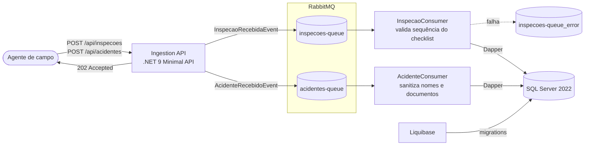
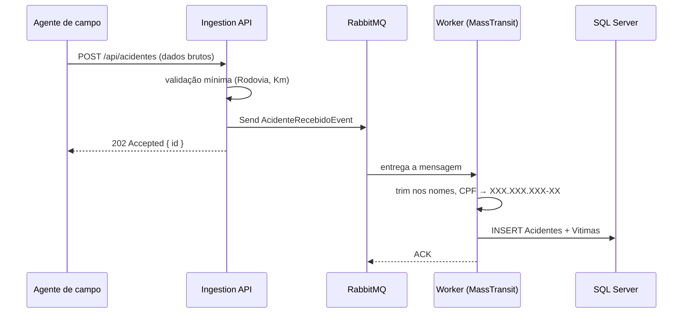
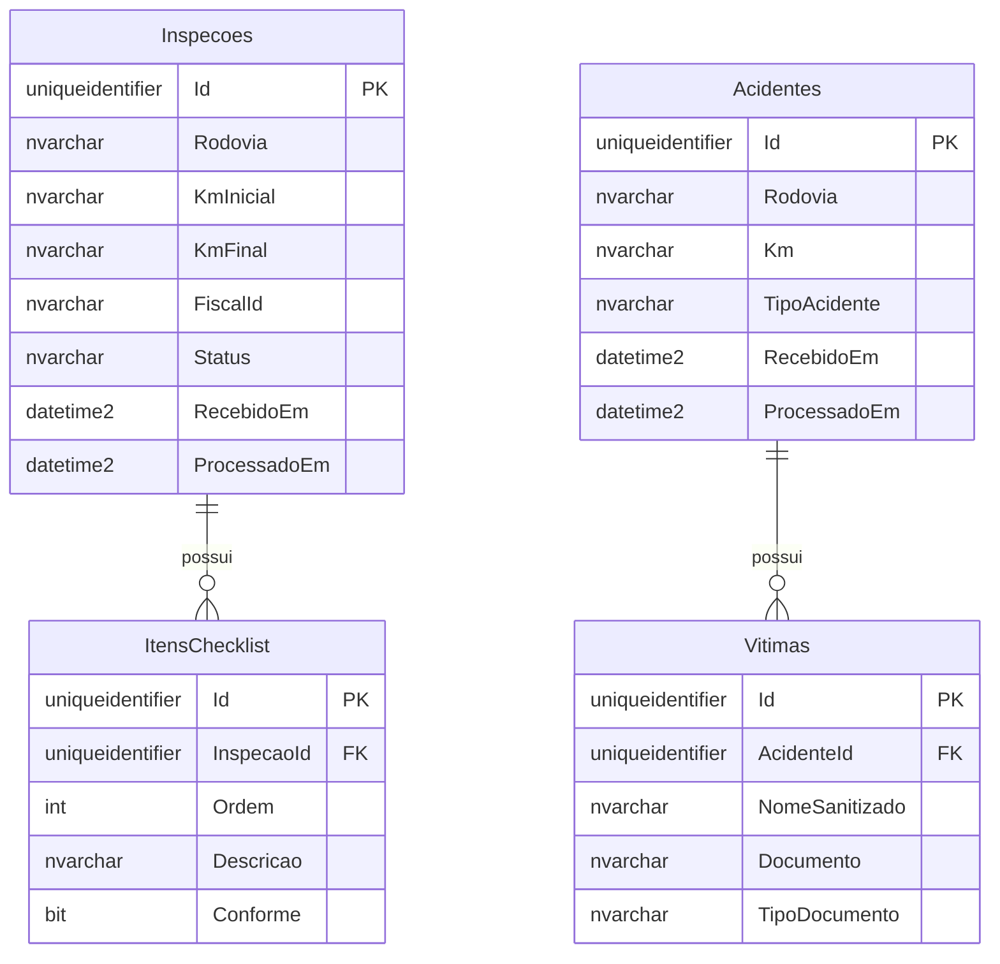

# 🛣️ Highway Monitor

> API de ingestão + workers assíncronos para relatórios de inspeção e acidentes rodoviários, construída com **Arquitetura Orientada a Eventos** em .NET 9, RabbitMQ e SQL Server.

[](https://dotnet.microsoft.com/)
[](https://www.rabbitmq.com/)
[](https://masstransit.io/)
[](https://www.microsoft.com/sql-server)
[](https://www.docker.com/)
[](https://www.liquibase.org/)

> 🇺🇸 **TL;DR (English):** event-driven back-end in .NET 9. A Minimal API accepts field reports and returns `202 Accepted` immediately; MassTransit consumers on RabbitMQ validate, sanitize and persist the data to SQL Server with Dapper. The schema is versioned with Liquibase and the whole stack starts with a single `docker compose up`.

---

## 📌 Destaques

- **Event-Driven Architecture**: a API só publica eventos; quem processa são workers desacoplados.
- **RabbitMQ + MassTransit**: uma fila por domínio, serialização e *error queue* gerenciadas pelo MassTransit.
- **HTTP 202 Accepted**: a API responde em milissegundos, sem tocar no banco.
- **Contratos compartilhados** em uma class library (`HighwayMonitor.Contracts`): API e Worker não se conhecem.
- **Dapper + SQL explícito**: controle total sobre as queries e performance previsível.
- **Liquibase**: o schema é versionado como código SQL, revisável e reproduzível.
- **Docker Compose com healthchecks**: banco → migrations → broker → API → worker, na ordem certa e com um comando só.

---

## 🏗️ Arquitetura



### Fluxo de uma requisição



### Por que orientado a eventos?

A API de ingestão e os workers são **completamente desacoplados**. A API não sabe quantos workers existem nem se eles estão no ar: se o worker cair, as mensagens ficam na fila e são processadas quando ele voltar. Um pico de acidentes não atrasa as inspeções, porque cada domínio tem a sua fila. Um novo consumidor (notificações, relatórios) entra sem nenhuma mudança na API.

---

## 🧰 Stack

| Camada | Tecnologia | Por quê |
|---|---|---|
| API de ingestão | .NET 9 Minimal API | Baixo overhead, resposta rápida com `202` |
| Message broker | RabbitMQ 3.13 | Filas duráveis, separação por domínio |
| Mensageria | MassTransit 8.3 | Abstrai conexão, serialização, ACK/NACK e error queue |
| Processamento | .NET 9 Worker Service | Processo de longa duração, sem HTTP |
| Acesso a dados | Dapper | SQL explícito, performance previsível |
| Banco | SQL Server 2022 | Integridade referencial e FKs |
| Versionamento do schema | Liquibase 4.27 | Schema como código, roda em container separado |
| Infraestrutura | Docker + Docker Compose | Ambiente completo com um comando |

---

## 📁 Estrutura

```
api-orientada-eventos/
├── docker-compose.yml
├── infra/
│   ├── liquibase/
│   │   ├── liquibase.properties
│   │   └── changelog/                 # 002..005: Inspecoes, ItensChecklist, Acidentes, Vitimas
│   └── sqlserver/init.sql
└── src/
    ├── HighwayMonitor.sln
    ├── HighwayMonitor.Contracts/      # Eventos e DTOs compartilhados (records)
    ├── HighwayMonitor.Api/            # Minimal API: valida e publica eventos
    └── HighwayMonitor.Worker/
        ├── Consumers/                 # InspecaoConsumer, AcidenteConsumer
        └── Repositories/              # Persistência com Dapper
```

---

## ▶️ Como rodar

**Pré-requisito:** apenas o [Docker Desktop](https://www.docker.com/products/docker-desktop). Não é preciso instalar .NET, SQL Server nem RabbitMQ.

```bash
git clone https://github.com/rbarboteu/api-orientada-eventos.git
cd api-orientada-eventos
docker compose up --build
```

O Compose sobe tudo na ordem certa:

1. **SQL Server 2022**, com healthcheck que cria o banco `HighwayMonitorDb`.
2. **Liquibase**, que aplica as migrations e encerra.
3. **RabbitMQ** com o painel de gerenciamento.
4. **API** na porta `8080`.
5. **Worker**, que só inicia depois que as migrations terminam com sucesso.

> Na primeira execução, o SQL Server leva de 45 a 60 segundos para ficar saudável.

| Serviço | Endereço | Credenciais (ambiente local) |
|---|---|---|
| API | http://localhost:8080 | — |
| RabbitMQ Management | http://localhost:15672 | `highway_user` / `Highway@123456` |
| SQL Server | `localhost,1433` | `sa` / `Highway@123456` |

> As credenciais acima são apenas para desenvolvimento local.

### Teste rápido

```bash
curl -i -X POST http://localhost:8080/api/acidentes \
  -H "Content-Type: application/json" \
  -d '{"rodovia":"SP-280","km":"45","tipoAcidente":"Colisão","vitimas":[{"nomeRaw":"  João da Silva  ","documentoRaw":"12345678909","tipoDocumento":"cpf"}]}'
```

Depois, acompanhe o processamento com `docker compose logs -f worker` e veja as mensagens passando no painel do RabbitMQ.

### Desenvolvimento fora do Docker

```bash
docker compose up sqlserver rabbitmq liquibase -d   # só a infraestrutura

dotnet run --project src/HighwayMonitor.Api          # terminal 1
dotnet run --project src/HighwayMonitor.Worker       # terminal 2
```

Os `appsettings.json` já apontam para `localhost`.

---

## 📡 API

### `POST /api/inspecoes`

```json
{
  "rodovia": "SP-280",
  "kmInicial": "45",
  "kmFinal": "46",
  "fiscalId": "F-001",
  "checklist": [
    { "ordem": 1, "descricao": "Verificar sinalização", "conforme": true },
    { "ordem": 2, "descricao": "Verificar iluminação", "conforme": false },
    { "ordem": 3, "descricao": "Verificar asfalto", "conforme": true }
  ]
}
```

**Resposta:** `202 Accepted`

```json
{ "id": "3fa85f64-5717-4562-b3fc-2c963f66afa6", "mensagem": "Inspeção recebida e em processamento." }
```

**Regra de negócio:** o checklist precisa formar uma sequência completa `1..N`, sem lacunas nem repetições. Se a sequência estiver quebrada, o consumer lança exceção e o MassTransit move a mensagem para `inspecoes-queue_error`, onde ela fica disponível para análise.

### `POST /api/acidentes`

```json
{
  "rodovia": "SP-280",
  "km": "45",
  "tipoAcidente": "Colisão",
  "vitimas": [
    { "nomeRaw": "  João da Silva  ", "documentoRaw": "123.456.789-09", "tipoDocumento": "CPF" }
  ]
}
```

**Resposta:** `202 Accepted`

**Regra de negócio:** toda a sanitização acontece no worker, nunca no cliente. Ele remove espaços extras dos nomes, mantém só os dígitos dos documentos, formata CPFs como `XXX.XXX.XXX-XX` e normaliza o tipo de documento para maiúsculas.

Payloads sem `rodovia` / `fiscalId` (inspeções) ou sem `rodovia` / `km` (acidentes) recebem `400 Bad Request`.

---

## 🗄️ Modelo de dados



`ItensChecklist.Ordem` é `NOT NULL` e tem índice composto em `(InspecaoId, Ordem)`, então a regra é reforçada também no banco e a consulta por sequência continua rápida com volume alto.

---

## 🧠 Decisões de arquitetura

1. **`202 Accepted`, nunca `200 OK`.** A API não grava nada: publica o evento e devolve o `id`. `200` daria a entender que o trabalho já terminou.
2. **Uma fila por domínio.** `inspecoes-queue` e `acidentes-queue` são isoladas, então um pico em uma não atrasa a outra.
3. **Contratos em projeto próprio.** API e Worker dependem só de `HighwayMonitor.Contracts` e podem ser publicados de forma independente.
4. **Sanitização centralizada no Worker.** Dados brutos vêm de dispositivos móveis, e o worker é a única fonte de verdade sobre a qualidade deles: as regras ficam auditáveis e testáveis em um só lugar.
5. **Liquibase em vez de EF Migrations.** O schema vira SQL puro versionado, roda em um container separado do runtime da aplicação e pode ser revisado por qualquer pessoa do time, inclusive DBAs.

---

## 🗺️ Próximos passos

- [ ] Política de retry com backoff exponencial no MassTransit (`UseMessageRetry`) antes de enviar para a error queue
- [ ] Transação única para gravar o cabeçalho e os itens (inspeção + checklist, acidente + vítimas)
- [ ] Idempotência no consumer, usando o `Id` do evento
- [ ] Padrão Outbox para garantir a publicação mesmo se o broker estiver fora
- [ ] Testes de unidade das regras de sanitização e de integração com Testcontainers
- [ ] Health checks (`/health`) e observabilidade com OpenTelemetry
- [ ] Segredos via variáveis de ambiente / `.env` em vez de valores no `docker-compose.yml`

---

<p align="center">Desenvolvido por <a href="https://github.com/rbarboteu">Raphael Barboteu</a> · <a href="https://www.linkedin.com/in/raphael-barboteu-5827b223b/">LinkedIn</a></p>
